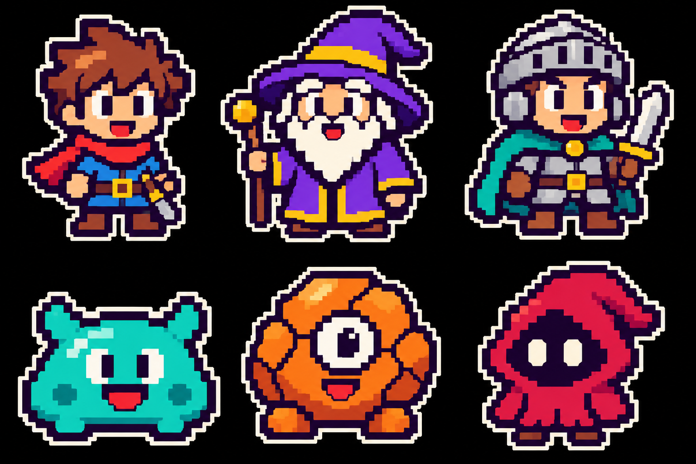

# 화면 구성 작업 기록

## 현재 화면 구성 기록 (2026-11-19, 풀이·답 제출 시안)

이 절은 이전 초기 화면·훈련·지도·수식 배치 기록보다 우선하는 현재 구현 상태다.

### 기본 화면

- 16:9 검은 배경. 격자·지형·사물·메뉴·HP 바는 표시하지 않는다.
- 위에서 내려다보는 3인칭 공간 개념으로 두 점을 화면 안에 배치한다.
- 주인공: 흰색 사각 점 0.12×0.12, Manim 중심 (−1.5, 1.125).
- 적: 붉은색 사각 점 0.12×0.12, 중심 (1.5, 1.125). 두 점은 화면 중앙 기준 좌우 대칭이다.
- 하단에는 배경 위에 겹친 빈 흰 테두리 대화창을 둔다. 너비 14.24, 높이 1.92, 중심 (0, −3.21).

### 적의 원본 수식

- 적의 오른쪽 위에 흰색 `x + 3 = 5`와 작은 붉은 표식을 표시한다.
- 적 점에서 수식까지 가는 붉은 꺾은 연결선을 흐리게 유지한다.
- 원본은 복사·풀이·답 제출 중에도 수정하거나 없애지 않는다.

### 주인공의 풀이

- 원본 수식의 복사본이 주인공의 왼쪽 위로 이동한다.
- 흰색의 흐린 꺾은 연결선으로 풀이 묶음과 주인공 점을 연결한다.
- 풀이를 세 줄로 누적하고 좌변·등호·우변을 분리해 등호의 세로 위치를 맞춘다.

```text
    x + 3 = 5
x + 3 − 3 = 5 − 3
        x = 2
```

- 원래 식과 최종 답은 흰색, 양변에서 3을 빼는 줄은 옅은 청색으로 구별한다.
- 1280×720 기준 풀이 등호 열은 x=300, 각 줄 기준선 y=145/180/217이다.
- 적의 원본은 우측 상단, 주인공의 풀이 흔적은 좌측 상단에 남아 서로의 역할을 구분한다.

### 진행과 제출

1. 적의 원본 문제 표시.
2. 복사본을 주인공 왼쪽 위로 이동.
3. 양변에서 3을 빼는 과정을 두 번째 줄에 표시.
4. 세 번째 줄에 `x = 2` 표시.
5. 별도 작은 테두리 안의 답 `2`를 주인공 부근에서 적 바로 앞까지 보낸 뒤 멈춤.

제출 후에도 원본과 풀이 세 줄을 유지한다. 피해·적 흔들림·정답 판정·소멸은 구현하지 않았다.
클릭 또는 Space/→로 진행하고, `처음부터`로 풀이 흔적과 제출 상태를 초기화한다.
짧은 복사·이동 동작 시간은 시안용이며 최종 영상 시간은 확정하지 않았다. 음성은 없다.

### 파일과 구현 범위

- 현재 진입점: `visual_library/previews/training/index.html`.
- Manim 바탕: `visual_library/previews/training/initial_screen.py`, `initial/screen.png`.
- 복사·풀이·제출 동작과 현재 좌측 풀이 배치는 HTML/SVG에서 구현한다.
- `initial/equation.png`는 적 수식 배치 확인용이며 현재 풀이·제출 전체 화면은 아니다.
- `scene.py`, `overworld.py`와 이전 프레임 폴더는 이전 시안이다. 현재 진입점에서 사용하지 않는다.


## 캐릭터 도트 스타일 기록 (2026-11-19)

사용자가 아래 6종 예시의 외형 방향을 선호한다고 확인했다.
현재 점 캐릭터를 교체한 것은 아니며, 실제 캐릭터 제작 시 시각 기준으로 사용한다.

- 위쪽 왼쪽부터: 견습 주인공, 마법사 스승, 기사.
- 아래쪽 왼쪽부터: 청록 슬라임, 주황 외눈 돌 몬스터, 붉은 후드 적.
- 굵은 짙은 보라색 윤곽선과 밝은 아이보리 외곽 테두리.
- 큰 눈과 명확한 표정, 큰 머리와 작은 몸, 구분되는 실루엣.
- 계단형 도트 경계, 제한된 색과 간결한 단계별 명암.
- 검은 배경에서도 작은 크기로 읽히는 표현을 우선한다.
- 개별 투명 스프라이트·이동 방향·애니메이션 프레임은 아직 제작하지 않았다.
- 기존 점의 위치와 수식 연결·풀이·제출 구조는 유지한다.

예시는 내장 imagegen 도구로 만든 한 장의 스타일 검토용 이미지다.
최종 게임용 픽셀 격자나 24×24/32×32 규격이 검증된 에셋으로 취급하지 않는다.




## 현재 주인공 애니메이션 기준 (2026-11-19 저장)

- 기준 미리보기: `hero_animation_shortlegs.gif`.
- 머리와 상체의 원래 비율을 유지하고 **하체 길이만 줄인다**. 전체 세로 축소 버전은 사용하지 않는다.
- 걷기는 접지 A → 통과 A → 접지 B → 통과 B의 네 자세다. 차렷식 발 모으기를 끼우지 않는다.
- 팔과 반대쪽 다리가 교대하고, 칼은 같은 손에 든 채 팔을 따라 움직인다.
- 현재 적용 수치: 224×224 원본에서 y=153 위는 유지, 아래 71px를 43px로 단축. 프레임 배치 오프셋은 y=10.
- 시안은 대기 → 이동 → 칼 휘두르기 → 웃는 표정 순서로 반복한다. 본편 수식 시안에는 아직 캐릭터를 교체 적용하지 않았다.
- 원본·이전 시안은 보존한다. `build_preview.py`는 현재 하체 단축 버전을 재생성하도록 갱신했다.

[애니메이션 미리보기](character_demo/index.html) · [세부 기록](character_demo/README.md)

## 정지 캐릭터와 통나무 적용 (현재)

기존 좌우 점을 실제 정지 이미지로 교체했다. 주인공 중심 (−1.5,1.125),
통나무 중심 (1.5,1.125)을 유지한다. `assets/hero_idle.png`는 현재 주인공의
짧은 대기 자세, `assets/training_log.png`는 같은 보라 윤곽·아이보리 외곽선의
도트 통나무다. 통나무는 내장 imagegen으로 생성했다.
생성 프롬프트 요지: 검은 배경, 짧고 굵은 세로 통나무, 나이테와 껍질,
굵은 보라 윤곽과 아이보리 외곽선, 제한된 명암, 얼굴·팔다리 없음.
캐릭터와 통나무는 움직이지 않는다. 기존 수식 복사·풀이·제출 시안은 유지한다.
수식 연결선 시작점만 객체의 위쪽 가장자리 부근으로 조정했다.
